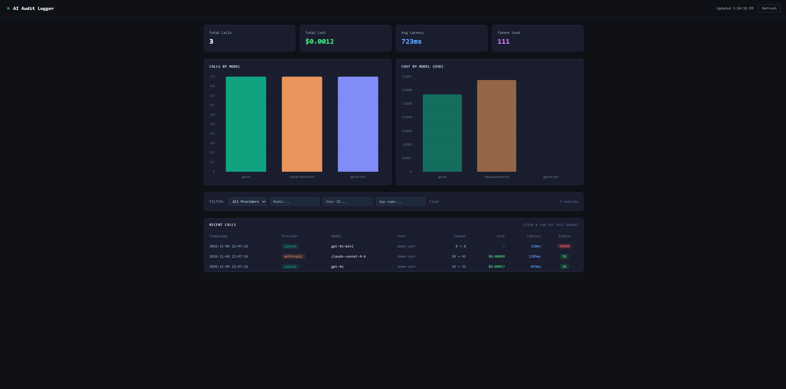
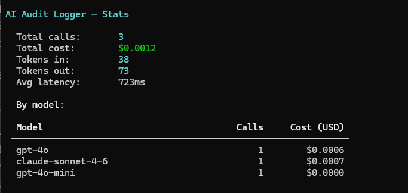

# AI Audit Logger


A self-hosted audit logger for LLM API calls. One line of code captures every OpenAI and Anthropic call — prompts, responses, tokens, cost, latency — and stores it in a queryable database.

Built for teams that need visibility into their AI usage for **debugging**, **cost control**, and **compliance** (EU AI Act, SOC 2).



---

## How it works

```
Your App  →  SDK (wrap your client)  →  Ingest API  →  Postgres
                                                            ↓
                                               CLI / Dashboard / Export
```

The SDK is a thin wrapper around your existing OpenAI or Anthropic client. It intercepts every call, records it asynchronously (never blocks your app), and ships it to the server.

---

## Quickstart

### 1. Start the server

```bash
git clone https://github.com/elliottj06/ai-audit-logger
cd ai-audit-logger
docker compose up -d
```

### 2. Wrap your client — one line change

**OpenAI:**
```python
from openai import OpenAI
from ai_audit_logger import wrap

client = wrap(OpenAI())

# Every call now logged automatically — no other changes needed
response = client.chat.completions.create(
    model="gpt-4o",
    messages=[{"role": "user", "content": "Hello"}]
)
```

**Anthropic:**
```python
from anthropic import Anthropic
from ai_audit_logger import wrap

client = wrap(Anthropic())

response = client.messages.create(
    model="claude-sonnet-4-6",
    max_tokens=1024,
    messages=[{"role": "user", "content": "Hello"}]
)
```

### 3. Query your logs

```bash
pip install -r cli/requirements.txt

python cli/main.py tail        # recent calls
python cli/main.py stats       # cost + usage summary
```

**`tail` output:**
```
Showing 3 of 3 entries

 Timestamp           Provider    Model                        Tokens        Cost          Latency
 ------------------- ----------- ---------------------------- ------------ ------------- ---------
 2026-11-04 14:23:01 openai      gpt-4o                       18→32         $0.00057      843ms
 2026-11-04 14:23:02 anthropic   claude-sonnet-4-6            20→41         $0.00068      1204ms
 2026-11-04 14:23:03 openai      gpt-4o-mini                  0→0           n/a           120ms    ERROR
```

**`stats` output:**



### 4. Open the dashboard

With the server running, open **http://localhost:8000** for the web dashboard: summary cards, calls and cost by model, and a filterable table of recent calls (click any row for full detail).

---

## Try it without API keys

Run the included example to send simulated log entries and see the CLI in action:

```bash
python examples/basic_usage.py
python cli/main.py tail
python cli/main.py stats
```

---

## Configuration

```python
from ai_audit_logger import configure

configure(
    server_url="http://localhost:8000",  # your server
    app_name="my-chatbot",              # tag logs by app
    user_id="user-123",                 # tie logs to a user
    session_id="session-abc",           # group calls into sessions
    redact_prompts=False,               # True = omit prompt text from logs
    enabled=True,
)
```

| Env var | Default | Description |
|---|---|---|
| `AUDIT_SERVER_URL` | `http://localhost:8000` | Ingest server URL |
| `AUDIT_APP_NAME` | (none) | Tag logs with your app name |
| `AUDIT_ENABLED` | `true` | Set `false` to disable without code changes |
| `AUDIT_REDACT_PROMPTS` | `false` | Omit prompt/response text (privacy mode) |

---

## API

| Endpoint | Method | Description |
|---|---|---|
| `/api/v1/log` | POST | Ingest a log entry |
| `/api/v1/logs` | GET | Query logs (filter by provider, model, user, app, session) |
| `/api/v1/logs/stats` | GET | Aggregated stats — total calls, cost, tokens, latency |
| `/health` | GET | Health check |

---

## Project structure

```
ai-audit-logger/
├── server/                  # FastAPI ingest + query API
│   ├── main.py
│   ├── models.py            # SQLAlchemy LogEntry model
│   ├── db.py                # Postgres connection
│   ├── routes/
│   │   ├── ingest.py        # POST /api/v1/log
│   │   └── query.py         # GET /api/v1/logs + /stats
│   └── static/index.html    # Web dashboard (served at /)
├── sdk/python/              # Python SDK
│   └── ai_audit_logger/
│       ├── __init__.py      # wrap() + configure()
│       ├── wrapper.py       # OpenAI + Anthropic wrappers
│       ├── client.py        # Fire-and-forget HTTP sender
│       └── config.py        # AuditConfig dataclass
├── cli/
│   └── main.py              # tail / stats / get commands
├── examples/
│   └── basic_usage.py       # Try it without API keys
└── docker-compose.yml
```

---

## Roadmap

### Core (open source)
- [x] Python SDK — OpenAI, Anthropic, Gemini
- [x] Web dashboard with cost charts
- [x] Proxy mode — zero code changes required
- [x] Publish to PyPI (`pip install ai-audit-logger`)
- [x] CSV / JSONL compliance export
- [x] Slack cost spike alerts
- [ ] TypeScript / Node.js SDK
- [ ] LangChain integration
- [ ] Tamper-evident log hashing for compliance exports

### Managed / Team tier (future paid product)
The self-hosted version stays free forever. The managed tier is where the business lives —
teams with 10+ engineers, compliance requirements, and a CTO asking "how much are we spending on AI?"

- [ ] User auth (email/password + Google SSO)
- [ ] Organisations and workspaces
- [ ] Role-based access (admin, developer, viewer)
- [ ] Per-user API key management
- [ ] Usage limits and budgets per user
- [ ] Stripe billing integration
- [ ] Cloud-hosted, managed infrastructure

> **Model inspiration:** Grafana, Metabase, PostHog — open core, free self-hosted, paid managed cloud.

---

## License

MIT
